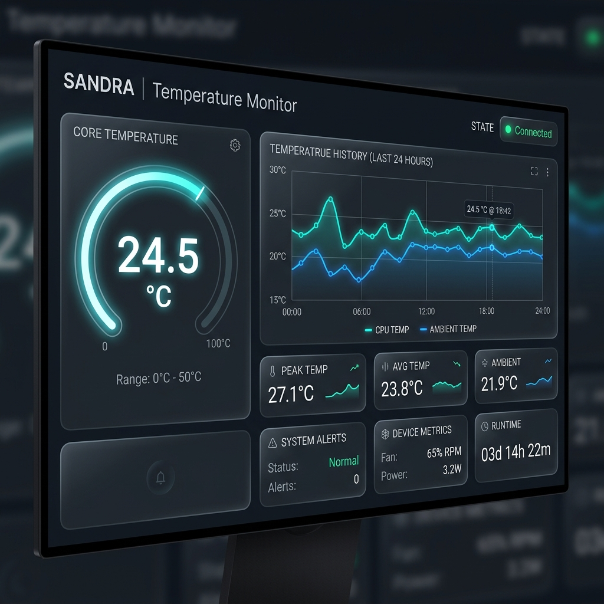
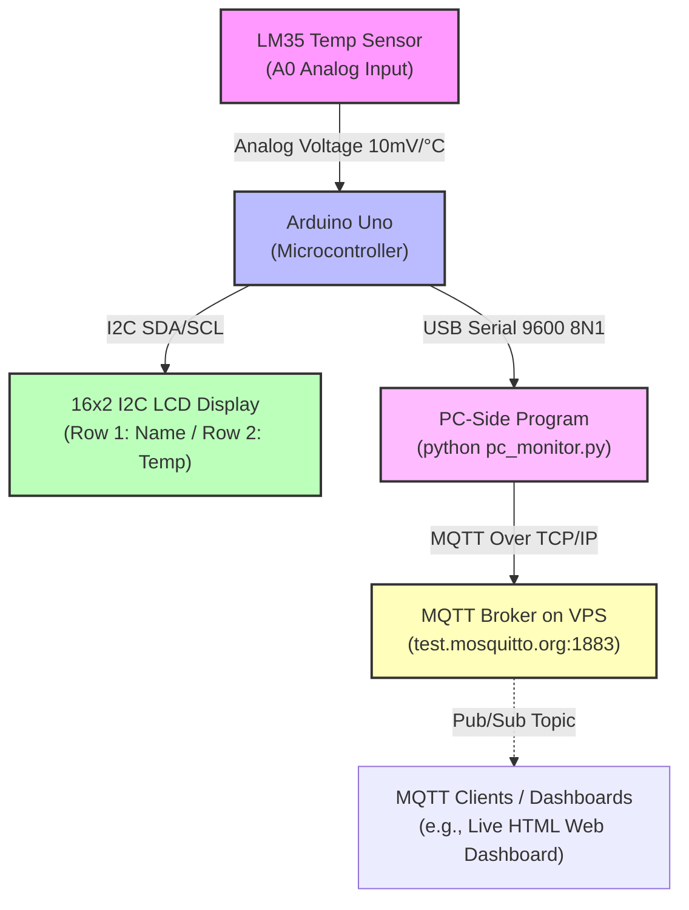

# Temperature Display & MQTT Monitoring System

This project is a simple, robust embedded system designed to read temperature data from a sensor using an Arduino Uno, display the information on a 16x2 I2C LCD display, transmit the data to a PC via serial communication, and finally publish the readings to a remote MQTT broker on a VPS.

## Web Dashboard Preview


A live, web-based dashboard is available at:
👉 **[https://lfga-10.github.io/Temperature_Sensor-MQTT/](https://lfga-10.github.io/Temperature_Sensor-MQTT/)**

*Note: To run the dashboard locally, simply double-click the [index.html](index.html) file.*

---

## a) System Architecture Diagram



### System Flow
1. **LM35 Temperature Sensor**: Reads physical temperature and outputs a voltage proportional to Celsius (10mV/°C).
2. **Arduino Uno**: Reads the analog voltage, averages readings for noise filtering, displays values on the LCD, and writes the numeric value to the serial port.
3. **16x2 I2C LCD**: Displays "SANDRA" on Row 1 (with smooth scrolling if a longer name is configured) and the temperature in °C on Row 2.
4. **PC Program**: Connects to the Arduino via USB, reads the incoming temperature values line-by-line, and publishes them.
5. **MQTT Broker**: Receives the published data on the topic `sensor/arduino/temperature` for remote monitoring.

---

## b) Hardware Setup & Wiring

### 1. Pin Mapping Table

| Component | Component Pin | Arduino Uno Pin | Notes |
| :--- | :--- | :--- | :--- |
| **LM35 Sensor** | VCC (Power) | **Digital Pin 8** | Powered by Arduino setting Pin 8 to HIGH |
| | OUT (Signal) | **Analog Pin A0** | Analog input |
| | GND | **GND** | Ground reference |
| **16x2 I2C LCD** | VCC | **5V** | Power supply |
| | GND | **GND** | Ground reference |
| | SDA | **Analog Pin A4** | I2C Data line |
| | SCL | **Analog Pin A5** | I2C Clock line |

---

## c) Horizontal Scrolling for Row 1

The Arduino sketch implements **non-blocking scrolling** using `millis()`. 
- If the name length is $\le 16$ characters, it remains static.
- If it exceeds 16 characters, a sliding 16-character window moves through a padded string containing the name plus 4 spaces to ensure a clean visual wrap-around.
- Because it utilizes the non-blocking state machine pattern, the scrolling has **no impact** on the temperature reading frequency or Serial transmission.

To test this feature, open [arduino_temp_display.ino](file:///c:/Users/HP/Documents/EMBEDDED%20WORK/Temperature%20Display%20and%20MQTT%20Monitoring/arduino_temp_display/arduino_temp_display.ino) and modify the `displayName` variable to:
```cpp
const char* displayName = "Sandra - Embedded Systems Engineer";
```

---

## d) PC-Side Monitoring Script

The script is implemented in Python and bridges serial data to the MQTT broker.

### Installation & Setup

1. **Install Python 3** (if not already installed).
2. **Install Dependencies**:
   Open a terminal and run the following command to install required modules:
   ```bash
   pip install -r requirements.txt
   ```
3. **Run the Script**:
   ```bash
   python pc_monitor.py
   ```
   *Note: If multiple COM ports are found, the script will prompt you to choose. It will auto-detect the port if only one is active.*

### Overrides (Optional)
Specify parameters using command-line flags:
```bash
python pc_monitor.py --port COM3 --broker 192.168.1.100 --topic test/temperature
```

---

## e) Communication Details & Names Used

### 1. Serial (UART) Communication between Arduino and PC
- **Communication Type**: **UART** (Universal Asynchronous Receiver-Transmitter) sent over a USB virtual COM port.
- **Port Name**: 
  - **Windows**: Identified as **COM ports** (e.g., `COM3`, `COM4`, etc.) in the Device Manager.
  - **Linux / macOS**: Identified as device files (e.g., `/dev/ttyACM0` or `/dev/tty.usbmodem*`).
- **Physical Interface**: USB-to-UART Converter. Common IC names found on Arduino boards include:
  - **ATmega16U2** (found on official Arduino Uno R3 boards).
  - **CH340G** or **CP2102** (found on standard clone/compatible boards).
- **Communication Settings (9600 8N1)**:
  - **Baud Rate**: **`9600` bits per second** (speed of transmission).
  - **Data Bits**: **`8`** (standard size for transmitting characters).
  - **Parity**: **`None`** (no parity bit for error checking).
  - **Stop Bits**: **`1`** (indicates end of a data packet).
  - **Flow Control**: **`None`** (no hardware/software handshake).

### 2. MQTT (VPS Transmission)
- **Protocol**: **MQTT** (Message Queuing Telemetry Transport) over TCP/IP.
- **Broker Hostname**: `test.mosquitto.org` (default public broker, can be replaced by your VPS IP address).
- **Broker Port**: `1883` (Standard unencrypted MQTT port).
- **Topic Name**: `sensor/arduino/temperature`
- **Quality of Service (QoS)**: `1` (At least once delivery confirmation).
